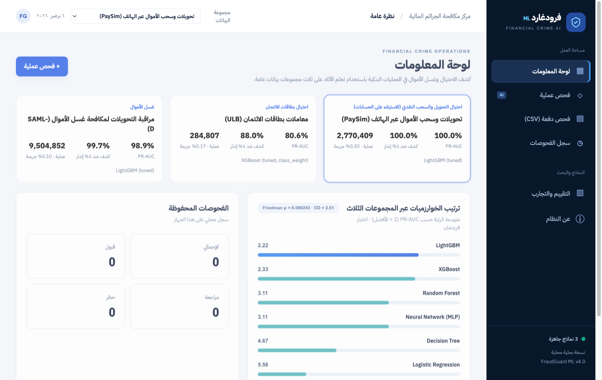
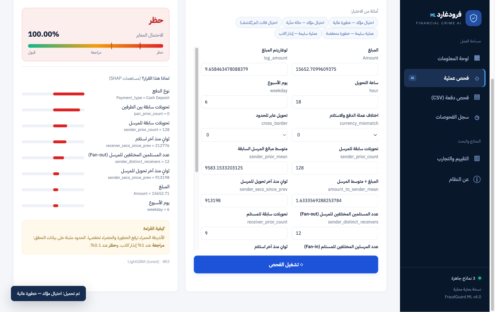

<div dir="rtl">

# فرودغارد FraudGuard

**كشف الاحتيال وغسل الأموال في العمليات البنكية باستخدام تعلم الآلة.**

[English](README.md) · [قاموس البيانات](docs/DATA.md) · [بيانات التدريب](https://github.com/amolood/fraudguard-ml/releases/tag/data-v4.0)

يقيّم النظام خطورة كل عملية بنكية ويوجّهها إلى **قبول** أو **مراجعة يدوية** أو **حظر**، مع تفسير كل قرار بقيم SHAP. يغطي ثلاثة أنواع من الجرائم المالية الإلكترونية على ثلاث مجموعات بيانات عامة، ويطبّق عليها بروتوكول تقييم واحداً. يتضمن تطبيق ويب محلياً (FastAPI وواجهة عربية) لفحص عملية واحدة أو ملف كامل.



## البيانات

| المجموعة | الجريمة | العمليات | نسبة الجريمة | الطبيعة | الترخيص |
|---|---|---|---|---|---|
| [PaySim](https://www.kaggle.com/datasets/ealaxi/paysim1) | احتيال التحويل والسحب النقدي | 2,770,409 | 0.30% | محاكاة من سجلات حقيقية | CC BY-SA 4.0 |
| [ULB](https://www.kaggle.com/datasets/mlg-ulb/creditcardfraud) | احتيال بطاقات الائتمان | 284,807 | 0.17% | حقيقية، مخفية الهوية بـ PCA | ODbL |
| [SAML-D](https://www.kaggle.com/datasets/berkanoztas/synthetic-transaction-monitoring-dataset-aml) | غسل الأموال | 9,504,852 | 0.10% | محاكاة لـ 28 نمطاً | CC BY-NC-SA 4.0 |

كل خاصية وطريقة حسابها وأحجام التقسيم موثقة في [docs/DATA.md](docs/DATA.md).

## التشغيل السريع

يتطلب Python 3.10 أو أحدث، ونحو 2 GB من المساحة.

```bash
git clone https://github.com/amolood/fraudguard-ml.git
cd fraudguard-ml
python -m venv .venv && source .venv/bin/activate
pip install -r requirements-dev.txt

python scripts/download_processed.py   # بيانات التدريب نفسها (~400 MB، مع التحقق من البصمة)
pytest -q                              # 12 اختباراً
./run.sh                               # http://127.0.0.1:8000 — توثيق الـ API في /docs
```

النماذج المدرّبة وكل النتائج موجودة في المستودع، فيعمل التطبيق دون إعادة تدريب.

### إعادة الإنتاج من المصادر الأصلية

```bash
python scripts/download_data.py   # البيانات الخام من Kaggle (~1.6 GB)
python -m fraudguard.prepare      # الخصائص والتقسيم الزمني (~30 ثانية)
python train.py                   # التدريب والتقييم الكامل (~25 دقيقة)
```

البذور العشوائية ثابتة، فتُعاد النتائج المنشورة نفسها.

## المنهجية

البروتوكول نفسه للمجموعات الثلاث:

1. **تقسيم زمني 60 / 20 / 20:** تدريب على الماضي، واختيار النموذج على الفترة التالية، واختبار مرة واحدة على أحدث فترة. يتم القطع على قيم الوقت، فلا تقع لحظة زمنية في مجموعتين.
2. **خصائص سلوك الحسابات بلا تسرب:** عدد العمليات السابقة، والزمن منذ آخر عملية، وعدد الأطراف المختلفة (Fan-in / Fan-out)، والعمليات السابقة بين الطرفين. كلها من العمليات **السابقة فقط**، ويتحقق من ذلك اختبار آلي.
3. **حذف ما يكشف الإجابة:**
   - عمود `Laundering_type` في SAML-D، لأنه يكشف التصنيف مباشرة.
   - خطأ توازن الأرصدة في PaySim، لأنه أثر من المحاكي.
4. **ست خوارزميات:** Logistic Regression، وDecision Tree، وRandom Forest، وNeural Network (MLP)، وXGBoost، وLightGBM. ضُبطت مكتبتا التعزيز ضبطاً متكافئاً قبل المقارنة.
5. **عدم التوازن:** مقارنة بين عدم المعالجة، وأوزان الفئات، وتقليل العينات، وSMOTE. إعادة التوازن تُطبَّق داخل التدريب فقط.
6. **المقاييس:** المقياس الأساسي PR-AUC، المناسب لنسب جريمة بين 0.1% و0.3%. ومعه ROC-AUC، ونسبة الكشف عند 1% و0.1% إنذار كاذب.
7. **الإحصاء:**
   - 3 بذور عشوائية لكل نموذج غير حتمي.
   - فترات ثقة Bootstrap طبقية، واختبار مزدوج للفرق مع أقرب منافس.
   - اختبار فريدمان مع الفرق الحرج لنيميني عبر 9 كتل (3 مجموعات × 3 بذور).
8. **نقاط التشغيل:** حد **المراجعة** عند 1% إنذار كاذب، وحد **الحظر** عند 0.1%، وكلاهما مثبت على بيانات التحقق. الاحتمالات معايرة بالانحدار الرتيب (Isotonic Regression).

## النتائج

PR-AUC على الاختبار (متوسط البذور). أفضل قيمة في كل مجموعة بخط عريض.

| الخوارزمية | PaySim | ULB | SAML-D | متوسط الرتبة ↓ |
|---|---|---|---|---|
| LightGBM | **1.000** | 0.801 | 0.989 | **2.22** |
| XGBoost | **1.000** | 0.789 | **0.990** | 2.33 |
| Random Forest | **1.000** | 0.802 | 0.889 | 3.11 |
| Neural Network (MLP) | 0.945 | **0.825** | 0.973 | 3.11 |
| Decision Tree | 0.9995 | 0.654 | 0.935 | 4.67 |
| Logistic Regression | 0.929 | 0.779 | 0.089 | 5.56 |

- **اختبار فريدمان:** χ² = 23.7، p = 0.0002، فالفروق بين الخوارزميات دالة.
- **الفرق الحرج لنيميني:** CD = 2.51. LightGBM وXGBoost أفضل دالاً من Logistic Regression، وبقية الفروق الثنائية غير دالة.

نقاط التشغيل للنموذج المختار على الاختبار:

| المجموعة | النموذج المختار | المراجعة: كشف / دقة | الحظر: كشف / دقة | زمن العملية |
|---|---|---|---|---|
| PaySim | LightGBM (مضبوط) | 100% / 49.7% | 99.98% / 91.1% | 1.2 ملّي ثانية |
| ULB | XGBoost (مضبوط، أوزان فئات) | 88.0% / 9.4% | 80.0% / 51.7% | 0.8 ملّي ثانية |
| SAML-D | LightGBM (مضبوط) | 99.7% / 11.2% | 99.0% / 53.1% | 1.5 ملّي ثانية |

## أهم النتائج

- **PaySim شبه قابل للفصل التام بسبب المحاكي.** حقول الأرصدة وحدها تعطي PR-AUC = 1.0، وبدونها ينخفض إلى **0.38**. المحاكي يولّد الاحتيال دائماً بنمط «تفريغ كامل الرصيد»، فنتائج PaySim تبالغ في تقدير الأداء الواقعي.
- **سلوك الحسابات هو ما يكشف غسل الأموال.** في SAML-D يبلغ PR-AUC **0.978** مع خصائص السلوك، و**0.077** بدونها.
- **إعادة التوازن لا تفيد.** الأوزان وتقليل العينات وSMOTE غيّرت PR-AUC بأقل من 0.004 في كل المجموعات، وأحياناً أساءت. اختيار عتبة القرار أهم.
- **الاختيار على تحقق صغير غير مستقر.** في ULB (57 حالة احتيال في التحقق) اختير XGBoost، لكن الشبكة العصبية كانت أفضل دالاً على الاختبار (p = 0.027).
- **الأداء ينحرف مع الزمن.** انخفض PR-AUC في ULB إلى 0.55 في الربع الأخير من الاختبار، وارتفعت نسبة الاحتيال في PaySim من 0.17% إلى 2.1%.

## التطبيق والواجهة البرمجية



| Method | Route | الوصف |
|---|---|---|
| `POST` | `/api/score/{dataset}` | `{"features": {...}}`: القرار، والاحتمال المعاير، وأهم أسباب SHAP |
| `POST` | `/api/score-batch/{dataset}` | ملف CSV بالأعمدة الأصلية؛ تُحسب خصائص السلوك من الملف، ويُقيَّم الأداء إن وُجد عمود التصنيف |
| `GET` | `/api/schema/{dataset}` | تعريف الحقول وأمثلة من الاختبار |
| `GET` | `/api/overview` | النتائج وإحصاءات الفحوصات |
| `GET` / `DELETE` | `/api/history` | سجل الفحوصات المحلي |

قيم `dataset` المتاحة: `paysim` و`ulb` و`samld`.

**الأمان:**
- الخادم للاستخدام المحلي، ويرفض أي عنوان Host غير محلي (`FRAUDGUARD_ALLOWED_HOSTS` لتعديل ذلك).
- طلبات التعديل تتطلب الترويسة `X-Requested-With: fraudguard-ui`.
- لا توجد مصادقة للمستخدمين، فلا تعرضه على شبكة كما هو.
- النماذج تُحمَّل بآلية pickle، فحمّل فقط نماذج دربتها بنفسك.

## حدود النظام

- **بيانات محاكاة:** PaySim وSAML-D محاكاة، والأداء الواقعي سيكون أقل.
- **ULB:** خصائصها مخفية بتحويل PCA، واختبارها يحوي 75 حالة احتيال فقط.
- **لا توجد خصائص ديموغرافية،** فلا يمكن تدقيق العدالة.
- **دعم القرار فقط:** النتيجة تقدير لمستوى الخطورة، وليست دليلاً على وقوع جريمة.

</div>
