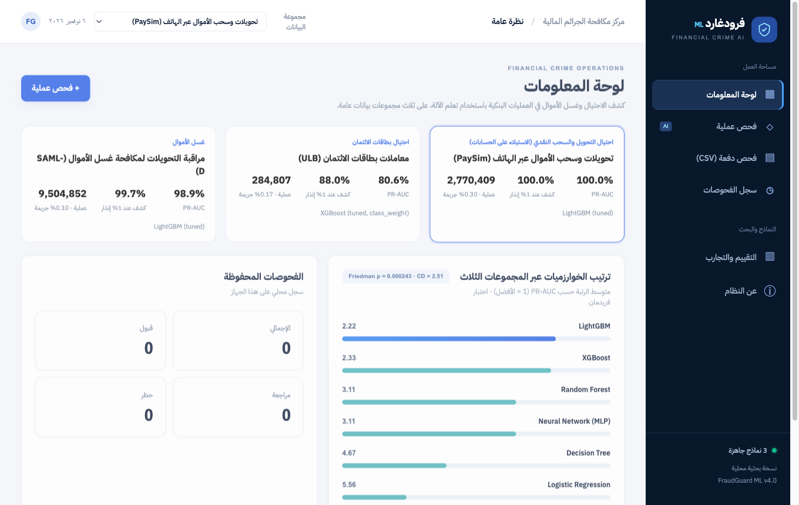
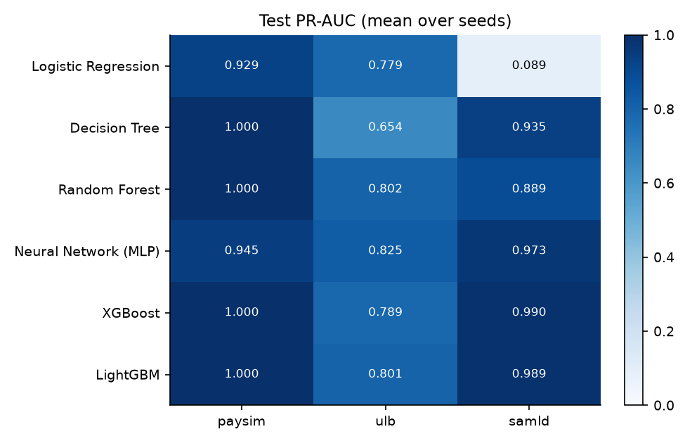
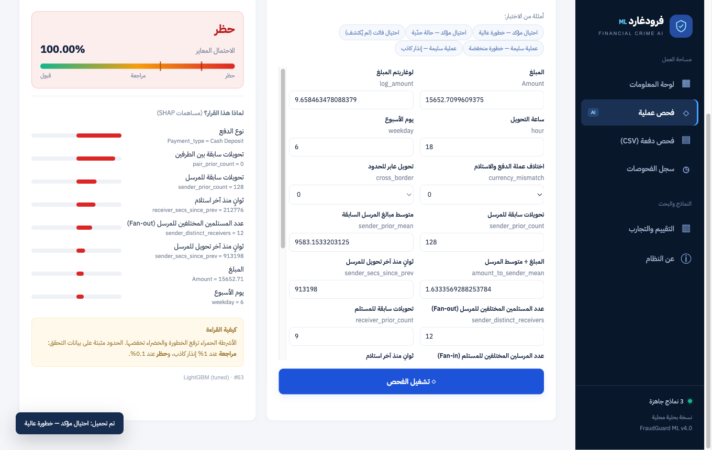

# FraudGuard

**Machine-learning detection of fraud and money laundering in banking transactions.**

[العربية](README.ar.md) · [Data dictionary](docs/DATA.md) · [Training data release](https://github.com/amolood/fraudguard-ml/releases/tag/data-v4.0)

FraudGuard scores each banking transaction for risk and routes it to **approve**, **manual review** or
**block**. Every decision comes with a SHAP explanation. The project covers three kinds of financial
cybercrime on three public datasets under a single evaluation protocol. It ships with a local web
application (FastAPI, Arabic RTL interface) for single and batch screening.



## Contents

- [Datasets](#datasets)
- [Quick start](#quick-start)
- [Method](#method)
- [Results](#results)
- [Key findings](#key-findings)
- [Web application and API](#web-application-and-api)
- [Project structure](#project-structure)
- [Limitations](#limitations)
- [References](#references)

## Datasets

| Dataset | Crime | Transactions | Positive rate | Nature | Licence |
|---|---|---|---|---|---|
| [PaySim](https://www.kaggle.com/datasets/ealaxi/paysim1) | Transfer / cash-out fraud | 2,770,409 | 0.30% | Simulated from real mobile-money logs | CC BY-SA 4.0 |
| [ULB](https://www.kaggle.com/datasets/mlg-ulb/creditcardfraud) | Credit-card fraud | 284,807 | 0.17% | Real, anonymised with PCA | ODbL |
| [SAML-D](https://www.kaggle.com/datasets/berkanoztas/synthetic-transaction-monitoring-dataset-aml) | Money laundering | 9,504,852 | 0.10% | Synthetic, 28 typologies | CC BY-NC-SA 4.0 |

Every feature, how it is computed, and each split is documented in [docs/DATA.md](docs/DATA.md).

## Quick start

Requires Python 3.10+ and about 2 GB of free disk space.

```bash
git clone https://github.com/amolood/fraudguard-ml.git
cd fraudguard-ml
python -m venv .venv && source .venv/bin/activate
pip install -r requirements-dev.txt

python scripts/download_processed.py   # exact training data from the release (~400 MB, checksum-verified)
pytest -q                              # 12 tests
./run.sh                               # web app on http://127.0.0.1:8000, API docs on /docs
```

The trained models (`models/*.joblib`) and all metrics (`models/metrics.json`) are in the repository,
so the web app runs without retraining.

### Reproduce from the original sources

```bash
python scripts/download_data.py   # raw data from Kaggle (~1.6 GB)
python -m fraudguard.prepare      # feature tables + temporal split (~30 s)
python train.py                   # full training and evaluation (~25 min on a 12-core laptop)
python train.py --datasets ulb --quick   # smoke run in seconds
```

`train.py` rewrites `models/` and `reports/`. Seeds are fixed, so the published numbers are reproduced.

## Method

The protocol is identical for the three datasets.

1. **Temporal split 60 / 20 / 20.** Models train on the past, are selected on the next period, and are
   tested once on the most recent period. The split cuts on time values, so no timestamp is shared
   between splits.
2. **Leakage-safe behavioural features.** Prior transaction counts, time since the account's previous
   transaction, distinct counterparties (fan-in and fan-out), and prior transfers between the same pair.
   All of them use earlier transactions only, and this is checked by a unit test.
3. **Leakage removed.** SAML-D's `Laundering_type` column names the label, so it is dropped. PaySim's
   balance-error features are a simulator artefact, so they are excluded from the main models.
4. **Six algorithms.** Logistic Regression, Decision Tree, Random Forest, Neural Network (MLP), XGBoost
   and LightGBM. Both gradient-boosting libraries get the same tuning budget before they are compared.
5. **Class imbalance.** No treatment, class weights, random undersampling and SMOTE are compared.
   Resampling is applied inside training only.
6. **Metrics.** The primary metric is PR-AUC, which suits positive rates between 0.1% and 0.3%. ROC-AUC
   and recall at 1% and 0.1% false-positive rate are also reported.
7. **Statistics.** Each stochastic model runs with three seeds. The final model gets stratified bootstrap
   95% confidence intervals and a paired bootstrap test against the runner-up. A Friedman test with
   Nemenyi critical difference compares the algorithms over 9 blocks (3 datasets × 3 seeds).
8. **Operating points.** The review threshold is set at 1% false-positive rate and the block threshold at
   0.1%, both fixed on validation. Probabilities are calibrated with isotonic regression on validation.

## Results

Test PR-AUC, mean over seeds. The best value per dataset is in bold.

| Algorithm | PaySim | ULB | SAML-D | Average rank ↓ |
|---|---|---|---|---|
| LightGBM | **1.000** | 0.801 | 0.989 | **2.22** |
| XGBoost | **1.000** | 0.789 | **0.990** | 2.33 |
| Random Forest | **1.000** | 0.802 | 0.889 | 3.11 |
| Neural Network (MLP) | 0.945 | **0.825** | 0.973 | 3.11 |
| Decision Tree | 0.9995 | 0.654 | 0.935 | 4.67 |
| Logistic Regression | 0.929 | 0.779 | 0.089 | 5.56 |

- **Friedman test:** χ² = 23.7, p = 0.0002, so the algorithms differ significantly.
- **Nemenyi critical difference:** CD = 2.51. LightGBM and XGBoost are significantly better than
  Logistic Regression. The other pairwise differences are not significant.



Operating points of the selected model on the test period:

| Dataset | Selected model | Review: recall / precision | Block: recall / precision | Latency per transaction |
|---|---|---|---|---|
| PaySim | LightGBM (tuned) | 100% / 49.7% | 99.98% / 91.1% | 1.2 ms |
| ULB | XGBoost (tuned, class weights) | 88.0% / 9.4% | 80.0% / 51.7% | 0.8 ms |
| SAML-D | LightGBM (tuned) | 99.7% / 11.2% | 99.0% / 53.1% | 1.5 ms |

Per-dataset figures (PR and ROC curves, SHAP importance, drift, confusion matrix) are in
[`reports/<dataset>/`](reports/). Every number above is in [`models/metrics.json`](models/metrics.json).

## Key findings

- **PaySim is almost trivially separable because of the simulator.** The balance fields alone give
  PR-AUC = 1.0. Without them it drops to **0.38**. The simulator always generates fraud as "drain the
  whole balance", so PaySim scores overstate real-world performance.
- **Account behaviour is what detects money laundering.** On SAML-D, PR-AUC is **0.978** with the
  behavioural features and **0.077** without them.
- **Rebalancing does not help.** Class weights, undersampling and SMOTE changed validation PR-AUC by less
  than 0.004 on every dataset, and sometimes made it worse. Choosing the decision threshold matters more.
- **Selecting on a small validation set is unstable.** On ULB, with only 57 frauds in validation, XGBoost
  was selected. On the test period the MLP was significantly better (paired bootstrap, p = 0.027).
- **Performance drifts over time.** ULB's PR-AUC falls to 0.55 in the last test quarter. PaySim's fraud
  rate rises from 0.17% to 2.1% across the test period.

## Web application and API



The interface is in Arabic (RTL). It provides a dashboard, single-transaction screening with SHAP
reasons, batch screening of a CSV file, a local history, and an evaluation page with all figures.

| Method | Route | Description |
|---|---|---|
| `POST` | `/api/score/{dataset}` | Body `{"features": {...}}`. Returns the decision, calibrated probability and top SHAP reasons. Missing features fall back to the training median. |
| `POST` | `/api/score-batch/{dataset}` | Multipart CSV with the dataset's original columns. Behavioural features are computed from the file, and a label column triggers a live evaluation. |
| `GET` | `/api/schema/{dataset}` | Feature definitions and example transactions from the test period |
| `GET` | `/api/overview` | Metrics for every dataset and screening statistics |
| `GET` / `DELETE` | `/api/history` | Local screening log (SQLite) |
| `GET` | `/api/health` | Service status |

`dataset` is one of `paysim`, `ulb` or `samld`.

Example request:

```bash
curl -s -X POST http://127.0.0.1:8000/api/score/samld \
  -H 'Content-Type: application/json' -H 'X-Requested-With: fraudguard-ui' \
  -d '{"features": {"Amount": 15652.7, "Payment_type": "Cash Deposit", "pair_prior_count": 0}}'
```

**Security.** The service is meant to run locally. It accepts only local `Host` headers, which blocks DNS
rebinding; set `FRAUDGUARD_ALLOWED_HOSTS` to change this. State-changing requests must carry
`X-Requested-With: fraudguard-ui`. There is no user authentication, so do not expose the service on a
network as it is. Model files are loaded with pickle (`joblib`), so load only models you trained yourself.

## Project structure

```
fraudguard/datasets.py        dataset adapters and leakage-safe feature engineering
fraudguard/prepare.py         feature tables and temporal split
train.py                      training, tuning, ablations, statistics and figures
app/main.py                   FastAPI service
app/static/                   web interface (HTML, CSS, JS)
models/                       trained models and metrics.json
reports/                      figures (summary and per dataset)
scripts/download_data.py      raw data from Kaggle
scripts/download_processed.py processed training data from the release
docs/DATA.md                  data dictionary
tests/                        unit and API tests
```

## Limitations

- PaySim and SAML-D are simulated. Real-world performance will be lower.
- ULB's features are anonymised PCA components, so its explanations cannot be read as business
  attributes. Its test period holds only 75 frauds.
- None of the datasets includes demographic attributes, so no fairness audit is possible.
- Scores support an analyst's decision. They are not evidence that a crime took place.

## References

- Lopez-Rojas, E., Elmir, A., & Axelsson, S. (2016). PaySim: A financial mobile money simulator for fraud detection. *28th European Modeling and Simulation Symposium (EMSS)*.
- Dal Pozzolo, A., Caelen, O., Johnson, R. A., & Bontempi, G. (2015). Calibrating probability with undersampling for unbalanced classification. *IEEE Symposium Series on Computational Intelligence*.
- Oztas, B., Cetinkaya, D., Adedoyin, F., Budka, M., Dogan, H., & Aksu, G. (2023). Enhancing anti-money laundering: Development of a synthetic transaction monitoring dataset. *IEEE International Conference on e-Business Engineering (ICEBE)*.
- Ke, G., et al. (2017). LightGBM: A highly efficient gradient boosting decision tree. *NeurIPS 30*.
- Chen, T., & Guestrin, C. (2016). XGBoost: A scalable tree boosting system. *KDD*.
- Lundberg, S. M., & Lee, S.-I. (2017). A unified approach to interpreting model predictions. *NeurIPS 30*.
- Demšar, J. (2006). Statistical comparisons of classifiers over multiple data sets. *Journal of Machine Learning Research, 7*, 1–30.
